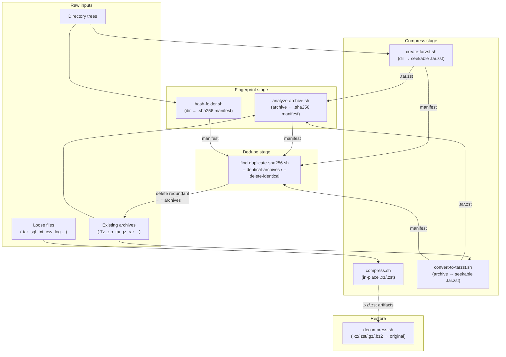

# Workflow — when and how to use each tool

The suite is built around one idea: **normalize everything to seekable
`.tar.zst`, fingerprint contents into `.sha256` manifests, then deduplicate on
the manifests.** Every tool either produces archives, produces manifests, or
consumes manifests.

## Pipeline diagram



(The diagram is interactive on GitHub — each node links to its tool page.)

## The recommended workflow

### 1. Collect / compress raw artifacts — `compress.sh`

Use when a directory accumulates large compressible files (database dumps,
logs, exports, unpacked tars) and you want them shrunk in place.

```bash
./compress.sh -d /data/dumps --sha256 originals.sha256
```

- Originals are replaced by `.xz` (or `.zst` with `--small/--big zstd`) files;
  pass `-k` to keep them.
- Capture `--sha256` before removal if you want a fingerprint of the
  *original* bytes for later verification.
- Skip this stage entirely if your data already lives inside archives — go
  straight to stage 2/3.

### 2. Normalize everything to `.tar.zst` — `convert-to-tarzst.sh` / `create-tarzst.sh`

`.tar.zst` produced by `pzstd` is **seekable** (embedded seek table), so these
archives can be browsed and partially extracted later — unlike `.7z`/`.zip`/
solid formats.

- `convert-to-tarzst.sh ARCHIVE` for existing `.7z`, `.zip`, `.tar.gz`,
  `.tar.xz`, `.tar.bz2`, `.tar`, `.tar.zst` inputs. `.7z`/`.zip` are extracted
  to a temp dir and repacked; tar streams pipe straight through.
- `create-tarzst.sh DIRECTORY` for a directory that should become an archive.
- Pass `--sha256` to either tool to get the manifest in the same pass — this
  skips a separate `analyze-archive.sh` run.
- Add `-r/--remove-source` only when you trust the conversion; the output is
  atomic so a successful run implies a complete archive.

```bash
./convert-to-tarzst.sh backups.7z --sha256
./create-tarzst.sh /var/backups/site --sha256
```

### 3. Fingerprint archive contents — `analyze-archive.sh`

For every archive that did **not** get a manifest in stage 2 (especially
legacy `.rar` and foreign archives you keep as-is):

```bash
find /data -type f \( -name '*.tar*' -o -name '*.7z' -o -name '*.zip' -o -name '*.rar' \) -print0 |
  parallel -0 -j8 --eta ./analyze-archive.sh {}
```

Each archive gets an `ARCHIVE-stem.sha256` listing `hash  path  size` per
member, computed in a single streaming pass — nothing is extracted to disk.

Optionally fingerprint plain directories too, so they participate in dedupe:

```bash
./hash-folder.sh /data/exports    # -> /data/exports.sha256
```

### 4. Find and remove redundancy — `find-duplicate-sha256.sh`

```bash
# Which payloads exist in multiple archives/dirs?
./find-duplicate-sha256.sh /data

# Which archives are byte-for-byte identical in content?
./find-duplicate-sha256.sh -A /data

# Interactively delete redundant copies (fzf multi-select or numbered prompt)
./find-duplicate-sha256.sh -A -D /data
```

Deletion removes the manifest **and** the archive **and** same-stem siblings
(`.sha1` files, logs). At least one member of every identical group is always
kept; `-y` auto-keeps the first (sorted) one.

### 5. Restore when needed — `decompress.sh`

```bash
./decompress.sh -d /data/dumps -j 8        # parallel restore
./decompress.sh -d /data/dumps -c xz       # only .xz/.txz
```

Restores `.xz/.txz`, `.zst/.tzst`, `.gz/.tgz`, `.bz2/.tbz*` next to the
source, repairs misnamed files via `file` magic, and preserves mtimes.
`.tar.zst` → `.tzst`-style outputs restore to `.tar`; unpack with `tar -xf`.

## Decision cheat-sheet

| Situation | Tool |
| --- | --- |
| Directory full of loose compressible files | `compress.sh` |
| Need a directory as a seekable archive | `create-tarzst.sh` |
| Have `.7z`/`.zip`/`.tar.*`/`.rar` to normalize | `convert-to-tarzst.sh` (7z/zip/tar*) — `.rar` is analyze-only, re-archive via extraction if needed |
| Need to know what's inside without extracting | `analyze-archive.sh` |
| Need a directory fingerprint | `hash-folder.sh` |
| Suspect duplicated content across archives | `find-duplicate-sha256.sh` |
| Byte-identical archives to clean up | `find-duplicate-sha256.sh -A -D` |
| Get original files back | `decompress.sh` |

## Manifest format contract

All producers emit the same layout, which is what makes cross-tool dedupe
work:

```
SHA256␣␣path␣␣size      (two spaces between fields, sorted by path)
```

`find-duplicate-sha256.sh` additionally accepts looser inputs (single space,
`hash *path` binary markers, missing size column), so externally generated
`sha256sum` files can be mixed in. Known limitation: filenames containing
newlines cannot be represented in this line-based format (tabs are fine).

## Standalone subproject

`tools/torrent_compress_recovery/` is an independent Python tool that
reconstructs compressed files referenced by a `.torrent` by recompressing
candidates until piece hashes match — see its
[own README](../tools/torrent_compress_recovery/README.md). It shares the
"recover compressed artifacts" theme but has its own CLI and test suite.
